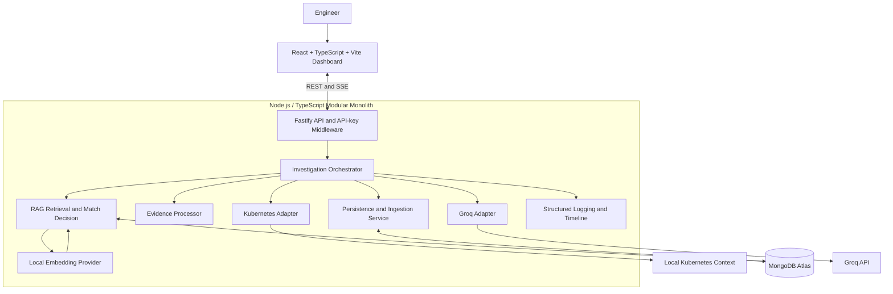
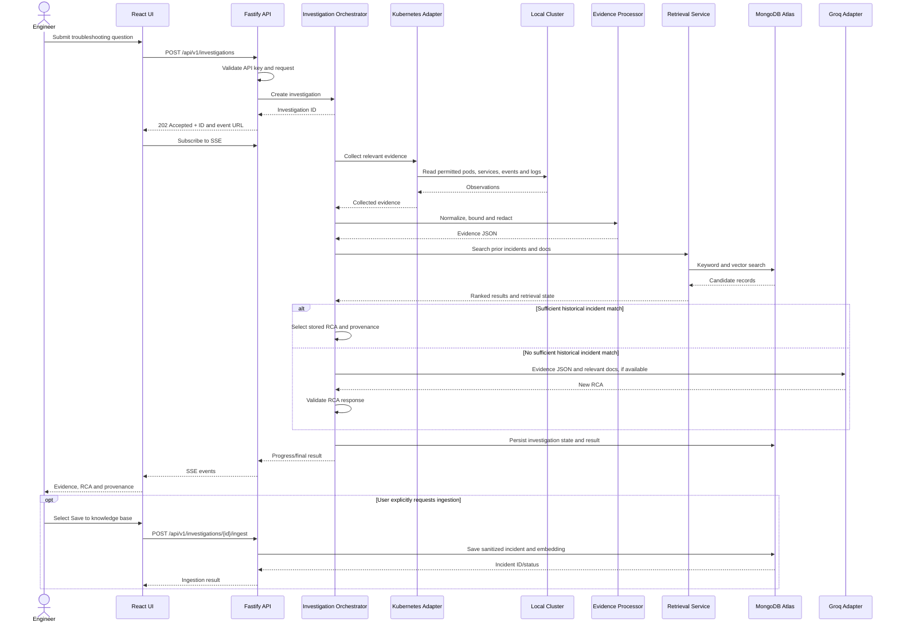
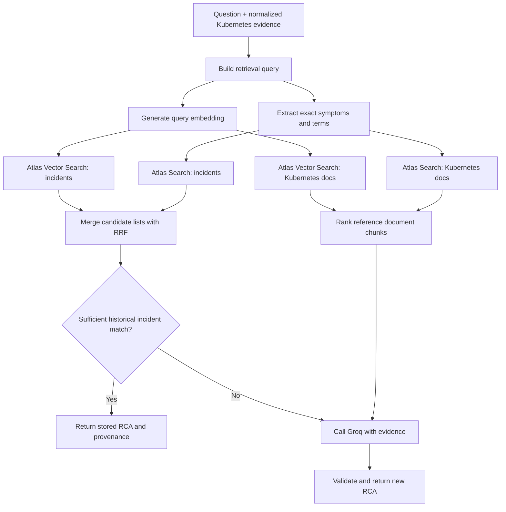
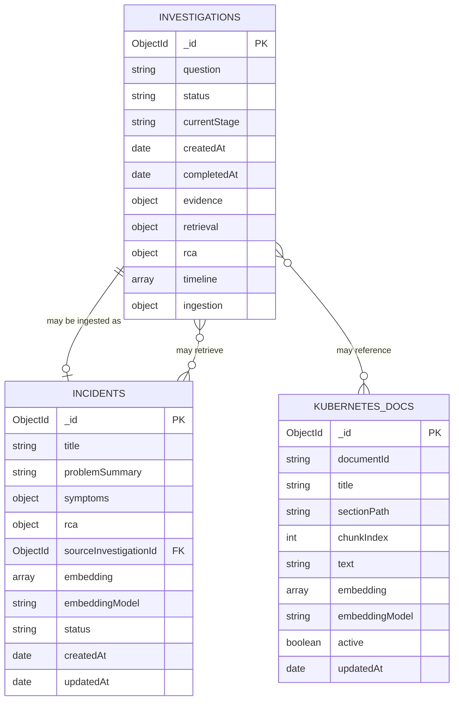
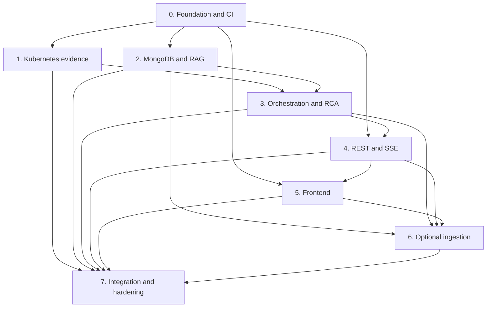

# kube-lens-ai — Architecture and Implementation Specification

> **Document status:** Approved design baseline; implementation has not yet been performed or verified.
>
> **Purpose:** Define the architecture, data contracts, security boundaries, implementation plan, and acceptance criteria for the `kube-lens-ai` MVP. This document records approved decisions and identifies remaining implementation-time choices. It does not claim that any component has already been built or tested.

## 1. Executive summary

`kube-lens-ai` is a local, single-user AI-assisted Kubernetes troubleshooting web application. An engineer asks why a workload or service is failing. The backend collects relevant Kubernetes evidence using read-only access, prepares a bounded and sanitized evidence JSON payload, checks MongoDB Atlas for a sufficiently relevant historical incident RCA, and uses the Groq API to generate a new RCA only when an appropriate historical incident is not available.

The engineer sees the investigation progress, evidence, relevant knowledge references, root-cause analysis (RCA), recommendations, and limitations in a React dashboard. Saving a newly generated problem/RCA to the incident knowledge base is an **explicit, optional action**. Investigation history is stored separately from the reusable incident knowledge base.

The system is a modular monolith. The frontend and backend run as local development processes; the backend communicates with the configured local Kubernetes context, MongoDB Atlas, a local embedding model, and Groq. The agent does not modify Kubernetes resources or execute remediation recommendations.

### 1.1 Core design principles

1. **Evidence before explanation:** collect observable cluster data before attempting an RCA.
2. **RAG first:** search for a relevant historical incident before calling Groq.
3. **No false no-match:** a retrieval outage is distinct from a successful search with no relevant incident.
4. **Read-only cluster access:** never create, patch, delete, exec into, or otherwise mutate cluster resources.
5. **Optional knowledge ingestion:** a new RCA is not automatically promoted to reusable incident knowledge.
6. **Visible provenance:** distinguish a stored historical RCA from a new LLM-generated RCA.
7. **Bounded and sanitized data:** minimize evidence sent to Groq or stored for later reuse.
8. **Local-first MVP:** keep operational complexity low; do not introduce microservices, a job queue, or a separate vector database.

## 2. Business use case and problem statement

### 2.1 Primary user

A single engineer troubleshooting a local development Kubernetes cluster, initially Kind or Minikube.

### 2.2 Problem

Troubleshooting commonly requires manually correlating pods, services, events, logs, resource status, past incidents, and Kubernetes reference documentation. These sources are disconnected, and unsupported AI explanations are difficult to trust when the evidence is not shown.

### 2.3 Proposed solution

The agent coordinates a repeatable investigation:

1. Accept a natural-language troubleshooting question and optional resource scope.
2. Collect relevant, read-only Kubernetes observations.
3. Normalize and sanitize the observations into evidence JSON.
4. Search MongoDB Atlas for relevant historical incident RCAs and Kubernetes documentation.
5. If a sufficiently relevant historical incident is found, present its stored RCA with provenance. Do not make an unnecessary Groq call for that path.
6. If no sufficiently relevant historical incident is found, send the evidence and relevant reference documentation (if any) to Groq for a new RCA.
7. Present progress, evidence, references, RCA, recommendations, and limitations.
8. Let the user optionally save the problem and RCA as reusable incident knowledge.

### 2.4 Objectives

- Reduce manual work spent gathering and correlating Kubernetes troubleshooting evidence.
- Reuse relevant incident knowledge where available.
- Generate a new evidence-grounded RCA when no suitable historical incident is found.
- Make the evidence and source of each RCA visible to the user.
- Keep the MVP simple to run, inspect, test, and demonstrate locally.

## 3. Scope

### 3.1 MVP functional requirements

- **FR-01 — Question submission:** accept a natural-language question and optional namespace/resource scope.
- **FR-02 — Read-only collection:** collect relevant pod information, service information, Kubernetes events, and bounded log excerpts.
- **FR-03 — Evidence preparation:** normalize, bound, and sanitize collected observations into a structured evidence payload.
- **FR-04 — RAG lookup:** search historical incidents and Kubernetes documentation stored in MongoDB Atlas.
- **FR-05 — Historical RCA response:** when a sufficiently relevant historical incident is identified, return its stored RCA and source metadata.
- **FR-06 — Groq fallback:** when no sufficiently relevant historical incident is found, use Groq to generate a new RCA from the available evidence and any relevant reference documentation.
- **FR-07 — Retrieval failure handling:** distinguish “search completed, no relevant incident” from “search unavailable or failed.”
- **FR-08 — Progress UI:** show investigation stages and current status through SSE, with REST state reconciliation.
- **FR-09 — Evidence and provenance:** display sanitized observations, knowledge references, RCA origin, and limitations.
- **FR-10 — Investigation history:** persist investigation status, timestamps, bounded evidence summary, retrieval outcome, RCA, and event timeline.
- **FR-11 — Optional ingestion:** let the user explicitly save a usable investigation problem/RCA into the searchable incident knowledge base.
- **FR-12 — Idempotency:** prevent repeated ingestion requests for the same investigation from creating duplicate incident records.
- **FR-13 — Local API protection:** protect application API endpoints with a backend-configured API key.
- **FR-14 — Diagnostics:** use structured local logs and expose safe, actionable errors.

### 3.2 Non-functional requirements

- **NFR-01 — Local operation:** the frontend and backend run as local processes.
- **NFR-02 — Read-only behavior:** cluster interactions are limited to read operations.
- **NFR-03 — Bounded inputs:** log volume, evidence payload, retrieval candidates, timeline size, and provider calls must be bounded.
- **NFR-04 — Failure isolation:** Kubernetes, MongoDB, embedding, and Groq failures should be represented distinctly.
- **NFR-05 — Privacy:** redact sensitive values where possible and avoid logging full raw evidence by default.
- **NFR-06 — Maintainability:** keep provider integrations behind module interfaces and use typed contracts.
- **NFR-07 — Testability:** mock external dependencies for routine tests and use separate local-cluster smoke tests.
- **NFR-08 — Progress recovery:** a reconnecting client can obtain the current investigation state and replay retained events where available.
- **NFR-09 — Local MVP scale:** optimize for one user and one investigation at a time; no throughput SLA has been specified.

### 3.3 Out of scope for the MVP

- Automated remediation or direct mutation of cluster resources.
- Multi-cluster fleet management.
- Multi-user accounts, roles, or multi-tenant isolation.
- Advanced reporting or production observability integrations.
- Runtime file-upload ingestion for documents or incident reports.
- Application deployment into Kubernetes, Docker Compose deployment, or hosted production deployment.
- Dedicated job queues, distributed workers, or a microservices architecture.
- Comprehensive browser end-to-end automation as a required CI gate.

## 4. Users, permissions, and trust boundaries

### 4.1 User model

The MVP has one local user and no application login. API endpoints use a shared local API key configured on the backend. This is a local-demo access control mechanism, not a user identity or multi-user authorization system.

### 4.2 Permission boundaries

| Component | Permitted actions | Prohibited actions |
|---|---|---|
| React frontend | Submit questions, read progress/results, request optional ingestion | Direct access to Kubernetes credentials, Groq secrets, or MongoDB credentials |
| Fastify API | Validate requests, authenticate the API key, coordinate application operations | Accept unvalidated payloads or expose credentials in errors |
| Kubernetes adapter | Read permitted resources, logs, and events | Create, update, patch, delete, exec, or apply resources |
| Retrieval/persistence modules | Search and store approved MongoDB records | Treat every investigation as trusted knowledge automatically |
| Groq adapter | Send minimized, sanitized evidence and selected reference context for analysis | Send credentials or unnecessary raw cluster content; execute generated actions |
| RCA output | Recommend investigation/remediation steps as text | Execute recommendations against the cluster |

### 4.3 Kubernetes scope

The backend uses the developer's configured kubeconfig and a read-only identity where possible. Namespace/resource scope should be explicit or resolved through a configured default. **Cluster-wide scanning should not be enabled by default without an intentional configuration decision.** Actual RBAC manifests or role definitions must be checked against the exact set of Kubernetes client calls implemented.

## 5. Approved technology stack

| Layer | Selected technology | Purpose and rationale |
|---|---|---|
| Runtime | Node.js 24 LTS | Local backend runtime with TypeScript support |
| Language | TypeScript, strict mode | Shared type discipline and safer contracts |
| Frontend | React 19, Vite 8 | Local single-page dashboard and fast development workflow |
| UI styling | Tailwind CSS | Lightweight, utility-based styling |
| Icons | `lucide-react` | Consistent UI icons |
| Frontend data fetching | Native Fetch; TanStack Query where useful | REST interaction and request state management |
| Backend framework | Fastify 5 | Modular HTTP server, plugin model, schema validation and structured logging |
| API schemas | TypeBox and `@fastify/type-provider-typebox` | Runtime validation and TypeScript-aligned endpoint contracts |
| Kubernetes integration | `@kubernetes/client-node` | Use the configured Kubernetes context and typed Kubernetes API calls |
| LLM | `groq-sdk` | Hosted RCA generation on the fallback path |
| Database | MongoDB Atlas, official `mongodb` Node.js driver | Investigation records, incident knowledge, reference docs and retrieval indexes |
| Embeddings | Transformers.js (`@huggingface/transformers`) with `all-MiniLM-L6-v2` as the initial candidate | Local sentence embeddings without adding another hosted embedding API |
| RAG | MongoDB Atlas Search + Atlas Vector Search + application-side Reciprocal Rank Fusion (RRF) | Hybrid exact/semantic retrieval without a separate vector database |
| SSE client | `@microsoft/fetch-event-source` | Supports request headers and controlled reconnect behavior |
| Tests | Vitest | Unit and integration tests aligned with Vite/TypeScript tooling |
| Code quality | ESLint, TypeScript checks, lockfile-based dependency installation | Lightweight CI validation |
| Logging | Fastify/Pino structured local logs | Step timing and safe diagnostics |

### 5.1 Version and dependency management

Use the major versions in the approved stack, then verify package compatibility and supported peer dependencies when initializing the repository. Pin exact resolutions in the package manager lockfile. Do not upgrade major versions without running the full test suite.

### 5.2 Embedding model baseline

`all-MiniLM-L6-v2` is the initial candidate; it produces 384-dimensional embeddings. The Vector Search index dimension must exactly match the selected embedding model. Keep the model identifier and dimension in configuration/metadata so a future model change can trigger a controlled re-embedding and index migration. The candidate must be evaluated on the curated Kubernetes incident set before its threshold is treated as suitable for reuse decisions.

### 5.3 Deliberately excluded dependencies

Do not introduce a separate vector database, message broker, agent orchestration framework, or microservices framework by default. Implement the known workflow explicitly in the investigation orchestrator. Add a new dependency only when a concrete requirement justifies its maintenance and operational cost.

## 6. High-level architecture



The diagram shows logical modules. They are not separate deployable services. The backend is one local process and the frontend is a separate local development process.

### 6.1 Component responsibilities

| Module | Responsibilities | Key interface/dependency |
|---|---|---|
| `api` | REST routes, schema validation, API key checking, SSE connection and response formatting | Fastify, contract schemas |
| `investigation` | Workflow state machine, orchestration, timeout boundaries, progress publishing | `KubernetesAdapter`, `KnowledgeRetriever`, `RcaProvider`, repositories |
| `kubernetes` | Query pods/services/events/logs using configured context | `@kubernetes/client-node` |
| `evidence` | Normalize observations, bound data, redact sensitive values and construct evidence JSON | Typed evidence contract |
| `retrieval` | Keyword retrieval, vector retrieval, candidate merging/ranking and incident-match decision | Atlas Search and Vector Search |
| `embeddings` | Embed query/incident/document text and expose model metadata | Transformers.js |
| `ai` | Construct grounded prompts, invoke Groq, parse and validate structured RCA | `groq-sdk` |
| `persistence` | Read/write investigation history, incidents and Kubernetes docs | MongoDB driver |
| `ingestion` | User-triggered, sanitized, idempotent promotion of an investigation RCA into incident knowledge | Investigation and incident repositories |
| `observability` | Structured logs, step durations and bounded event timeline | Pino and investigation event repository |

### 6.2 Recommended dependency interfaces

Keep the workflow independent from vendor-specific implementations. Proposed interfaces (names are illustrative):

```typescript
interface KubernetesAdapter {
  collectEvidence(input: InvestigationScope): Promise<KubernetesEvidence>;
}

interface EmbeddingProvider {
  embed(texts: string[]): Promise<number[][]>;
  modelId(): string;
  dimensions(): number;
}

interface KnowledgeRetriever {
  retrieve(input: RetrievalQuery): Promise<RetrievalResult>;
}

interface RcaProvider {
  generate(input: RcaInput): Promise<RcaResult>;
}

interface InvestigationRepository {
  create(input: NewInvestigation): Promise<InvestigationRecord>;
  getById(id: string): Promise<InvestigationRecord | null>;
  updateStatus(id: string, update: InvestigationUpdate): Promise<void>;
  appendEvent(id: string, event: InvestigationEvent): Promise<void>;
}
```

These interfaces allow tests to substitute mock adapters and keep the investigation flow independent of the selected SDKs.

## 7. Investigation lifecycle

### 7.1 Sequence



### 7.2 State machine

Overall status values:

- `queued`: accepted and persisted, execution has not yet started.
- `running`: investigation is in progress.
- `completed`: investigation produced a usable result without material incomplete steps.
- `partial`: a useful result exists but at least one material step/dependency was incomplete.
- `failed`: no usable RCA/result could be produced.

Recommended stages:

`accepted` → `collecting_evidence` → `preparing_evidence` → `retrieving_knowledge` → (`using_historical_rca` **or** `generating_rca`) → `persisting_result` → `completed` / `partial` / `failed`.

The API should persist status transitions before publishing the corresponding progress event. Terminal statuses must not transition back to `running` for the same investigation ID. If the local process terminates mid-investigation, a restart recovery check should mark stale in-progress records as interrupted/failed with a safe reason; no durable job queue or automatic job resumption is planned for the MVP.

### 7.3 RAG-first decision flow



#### Decision rules

1. Build retrieval text from the user's question plus normalized evidence: observed error tokens, event reasons, resource kind/name, status reasons, and compact sanitized log excerpts.
2. Search `incidents` and `kubernetes_docs` independently. Use keyword and vector retrieval for both where indexes are available.
3. Merge keyword and vector result rankings using application-side Reciprocal Rank Fusion (RRF) for the MVP. RRF weights/rank constants are configuration details to tune on the test set.
4. Treat a historical incident as a match only when the configured relevance threshold is met and relevant current evidence does not materially conflict with that incident. A raw vector similarity score is not a calibrated probability of identical root cause.
5. If a sufficiently relevant historical incident exists, return that incident's stored RCA and provenance. Do not call Groq for this path. Relevant documentation can be shown as supplementary reference material.
6. If no sufficiently relevant historical incident exists, call Groq with the current evidence and the most relevant documentation chunks, if any.
7. If MongoDB retrieval is unavailable, do not convert that failure into a no-match result. When evidence is sufficient, the backend may proceed to Groq while marking `retrieval.status = "unavailable"` and `retrieval.decision = "retrieval_failed"`.
8. If evidence is insufficient or Groq fails, return an explicit partial/failure result rather than inventing an RCA.

#### Initial retrieval configuration proposal

- Candidate count: start with up to five incident candidates from each retrieval path and up to five documentation candidates from each retrieval path; deduplicate before final ranking.
- Embedding baseline: `all-MiniLM-L6-v2`, 384 dimensions, cosine similarity, subject to evaluation.
- Incident decision threshold: configurable, initially uncalibrated; tune using positive and hard-negative test examples. Do not represent a similarity score as a probability.
- Use only active incident records and active documentation chunks in default retrieval.
- Make model ID/dimensions explicit metadata on every embedding record. Never compare vectors created by incompatible embedding models/dimensions.

### 7.4 Stored finding versus new analysis

The UI and API must identify RCA origin:

- `historical_incident`: a previously ingested incident RCA was returned.
- `groq`: a new RCA was generated through Groq.

A document-only RAG result is not a historical incident RCA. Documentation can ground a Groq-generated RCA, but must not be presented as though it confirms a past incident's root cause.

## 8. MongoDB data model

MongoDB references are logical application references, not relational foreign-key constraints. Use ObjectIds in stored references and serialize them as strings in APIs.



### 8.1 `investigations`

Purpose: history of every accepted investigation, including status, bounded evidence, retrieval outcome, RCA and progress events.

Proposed TypeScript document contract:

```typescript
interface InvestigationRecord {
  _id: ObjectId;
  schemaVersion: 1;
  question: string;
  scope?: {
    namespace?: string;
    resourceKind?: string;
    resourceName?: string;
  };
  status: "queued" | "running" | "completed" | "partial" | "failed";
  currentStage?: string;
  createdAt: Date;
  startedAt?: Date;
  completedAt?: Date;
  evidence?: {
    summary: string;
    observations: Array<{
      id: string;
      source: "pod" | "service" | "event" | "log";
      resource?: string;
      message: string;
    }>;
    collectionStats: {
      pods: number;
      services: number;
      events: number;
      logLines: number;
    };
    truncated: boolean;
  };
  retrieval?: {
    status: "completed" | "unavailable";
    decision: "historical_match" | "groq_fallback" | "retrieval_failed";
    incidentIds: ObjectId[];
    documentIds: ObjectId[];
  };
  rca?: {
    source: "historical_incident" | "groq";
    summary: string;
    rootCause: string;
    reasoning?: string;
    recommendations: Array<{
      text: string;
      rationale?: string;
      evidenceRefs: string[];
    }>;
    limitations: string[];
  };
  timeline: Array<{
    sequence: number;
    eventType: string;
    timestamp: Date;
    message: string;
  }>;
  ingestion: {
    status: "not_requested" | "succeeded" | "failed";
    incidentId?: ObjectId;
  };
  error?: {
    code: string;
    safeMessage: string;
  };
}
```

Notes:

- Do not persist unlimited raw log lines. Store sanitized excerpts, a summary and collection statistics under configured limits.
- Keep the timeline bounded. A proposed initial cap is 100 events per investigation; finalize the cap in configuration and tests.
- `retrieval.status` and `retrieval.decision` are separate so retrieval failure is not mistaken for successful no-match.
- The schema should allow a partial result even when a dependency fails, while reserving `failed` for cases with no usable result.

### 8.2 `incidents`

Purpose: reusable searchable knowledge consisting of a problem description, symptoms, stored RCA, provenance and embedding metadata. New records are created by explicit ingestion or a future curated-data process, not automatically for every investigation.

```typescript
interface IncidentRecord {
  _id: ObjectId;
  schemaVersion: 1;
  status: "active" | "inactive";
  title: string;
  problemSummary: string;
  symptoms: {
    errorTokens: string[];
    logPatterns: string[];
    resourceKinds: string[];
    relevantSignals: string[];
  };
  rca: {
    summary: string;
    details?: string;
    recommendedActions: Array<{
      text: string;
      rationale?: string;
    }>;
  };
  evidenceSummary: string;
  source: {
    type: "manual" | "investigation_ingestion";
    investigationId?: ObjectId;
    ingestedAt?: Date;
  };
  embedding: number[];
  embeddingModel: string;
  embeddingDimensions: number;
  contentHash: string;
  createdAt: Date;
  updatedAt: Date;
}
```

Notes:

- A unique partial index on `source.investigationId` for investigation-sourced incidents should enforce idempotent ingestion.
- Store compact symptom and RCA fields for retrieval and presentation. Avoid storing sensitive raw logs as reusable knowledge by default.
- Rebuild embeddings when the searchable source text changes or the embedding model changes.
- Preserve `source.investigationId` and timestamp for provenance.

### 8.3 `kubernetes_docs`

Purpose: curated Kubernetes reference documentation stored as searchable chunks. The MVP does not include an end-user file-upload pipeline; documents are added through seed/curation tooling or controlled data preparation.

```typescript
interface KubernetesDocChunk {
  _id: ObjectId;
  schemaVersion: 1;
  documentId: string;
  title: string;
  sourceUri?: string;
  version?: string;
  sectionPath: string;
  chunkIndex: number;
  text: string;
  keywords: string[];
  resourceKinds: string[];
  active: boolean;
  embedding: number[];
  embeddingModel: string;
  embeddingDimensions: number;
  contentHash: string;
  createdAt: Date;
  updatedAt: Date;
}
```

Store one searchable chunk per document record with parent-document identity and section metadata. This supports relevant retrieval while preserving the source context for UI citations.

### 8.4 Initial indexes

| Collection | Index | Purpose |
|---|---|---|
| `investigations` | `{ createdAt: -1 }` | Recent history |
| `investigations` | `{ status: 1, createdAt: -1 }` | Status/history filters |
| `incidents` | unique partial index on `source.investigationId` | Idempotent ingestion for investigation-sourced incidents |
| `incidents` | Atlas Search index on title, problem summary, error tokens, log patterns, RCA summary | Keyword retrieval |
| `incidents` | Atlas Vector Search on `embedding` plus filterable status/resource metadata as needed | Semantic retrieval |
| `kubernetes_docs` | Atlas Search index on title, section path, keywords and text | Keyword documentation retrieval |
| `kubernetes_docs` | Atlas Vector Search on `embedding` plus active/resource metadata as needed | Semantic documentation retrieval |

The vector index dimension must match the selected embedding model. The exact Atlas Search/Vector Search index syntax must be validated against the target Atlas deployment during Phase 2. Do not add a TTL index until the retention requirement is decided.

### 8.5 Example incident lifecycle

1. Investigation results are saved in `investigations`.
2. The user selects **Save to knowledge base**.
3. The backend validates that a usable RCA exists and sanitizes the source question, symptoms, evidence summary and RCA.
4. The embedding provider generates the incident embedding using the configured model.
5. The backend writes an `incidents` record with a reference to the source investigation and a content hash.
6. Subsequent retrieval indexes the incident, and future investigations may retrieve it if it matches.
7. If the same investigation is ingested again, the backend returns the existing incident reference rather than creating a duplicate.

## 9. Evidence JSON and RCA contracts

### 9.1 Evidence JSON

The evidence payload is the normalized input to retrieval and RCA generation. It must be bounded and sanitized. Example shape:

```typescript
interface KubernetesEvidence {
  collectedAt: string;
  clusterContextLabel?: string; // Non-secret display label only
  scope: {
    namespace?: string;
    resourceKind?: string;
    resourceName?: string;
  };
  observations: Array<{
    id: string; // e.g. E1, E2
    source: "pod" | "service" | "event" | "log";
    resource?: string;
    timestamp?: string;
    severity?: "info" | "warning" | "error" | "unknown";
    message: string;
  }>;
  summary: string;
  collectionStats: {
    pods: number;
    services: number;
    events: number;
    logLines: number;
  };
  truncated: boolean;
  limitations: string[];
}
```

Requirements:

- Observation IDs must be stable within one investigation so RCA recommendations can refer to them.
- Sanitize secrets, tokens, private credentials and unnecessary personal data before external submission or persistence.
- Preserve useful error tokens and event reasons where safe; over-redaction can reduce retrieval quality.
- Include a truncation indicator and collection limitations when evidence is bounded.
- Treat Kubernetes annotations, log lines, events and retrieved documents as untrusted text. They must not override the system's instructions or security rules.

### 9.2 RCA contract

```typescript
interface RcaResult {
  source: "historical_incident" | "groq";
  summary: string;
  rootCause: string;
  reasoning?: string;
  recommendations: Array<{
    text: string;
    rationale?: string;
    evidenceRefs: string[];
  }>;
  limitations: string[];
  references: Array<{
    type: "incident" | "kubernetes_doc" | "observation";
    id: string;
    title?: string;
  }>;
}
```

The backend must validate that referenced observation IDs exist in the current evidence and that incident/document references correspond to retrieved records. If Groq produces invalid structured output, the backend may attempt a bounded repair/retry according to configured policy; otherwise mark the analysis partial/failed instead of returning a fabricated diagnosis.

## 10. REST API design

Base path: `/api/v1`.

All `/api/v1` routes require `X-API-Key`. `/healthz` is the minimal unauthenticated liveness endpoint and must reveal no secrets, cluster data or internal configuration.

### 10.1 Endpoint summary

| Method | Endpoint | Purpose | Success response |
|---|---|---|---|
| `POST` | `/api/v1/investigations` | Create an investigation | `202 Accepted` with ID and links |
| `GET` | `/api/v1/investigations/:id` | Read current status/result | `200 OK` |
| `GET` | `/api/v1/investigations` | Browse history with pagination | `200 OK` |
| `GET` | `/api/v1/investigations/:id/events` | Receive SSE progress events | `200 OK`, `text/event-stream` |
| `POST` | `/api/v1/investigations/:id/ingest` | Explicitly save problem/RCA as an incident | `201 Created` new record; `200 OK` when already ingested |
| `GET` | `/api/v1/knowledge/incidents/:id` | Read a matched incident and its provenance | `200 OK` |
| `GET` | `/healthz` | Process liveness | `200 OK` |

### 10.2 Create an investigation

`POST /api/v1/investigations`

Request:

```json
{
  "question": "Why is checkout-api failing?",
  "scope": {
    "namespace": "demo",
    "resourceKind": "Deployment",
    "resourceName": "checkout-api"
  }
}
```

`scope` is optional. The backend must apply configured scope rules; it must not silently broaden an incomplete request to cluster-wide collection.

Response — `202 Accepted`:

```json
{
  "investigationId": "<mongo-object-id-as-string>",
  "status": "queued",
  "createdAt": "<ISO-8601 timestamp>",
  "links": {
    "self": "/api/v1/investigations/<id>",
    "events": "/api/v1/investigations/<id>/events"
  }
}
```

The endpoint validates the input, writes the initial record, starts the in-process asynchronous workflow and immediately returns the ID. A dedicated job queue is not included in the MVP; an application restart may interrupt an in-flight investigation.

### 10.3 Read status and result

`GET /api/v1/investigations/:id`

Return current status while running and the final result when complete. A completed response includes:

- `investigationId`, `question`, `status`, `currentStage`, `createdAt`, `completedAt`.
- Sanitized `evidence` and collection statistics.
- `retrieval.status`, `retrieval.decision`, matched incident IDs and documentation IDs.
- Structured `rca`, its origin, evidence references, source provenance and limitations.
- `ingestion.status` and the incident ID where applicable.
- A safe `error` object when a failure or partial result needs explanation.

Example response shape (illustrative data only):

```json
{
  "investigationId": "<id>",
  "status": "completed",
  "question": "Why is checkout-api failing?",
  "currentStage": "completed",
  "createdAt": "<ISO-8601 timestamp>",
  "completedAt": "<ISO-8601 timestamp>",
  "evidence": {
    "summary": "Several pods are restarting.",
    "observations": [
      {
        "id": "E1",
        "source": "event",
        "resource": "checkout-api",
        "message": "Illustrative sanitized observation"
      }
    ],
    "collectionStats": {
      "pods": 3,
      "services": 1,
      "events": 4,
      "logLines": 20
    },
    "truncated": false
  },
  "retrieval": {
    "status": "completed",
    "decision": "groq_fallback",
    "incidentIds": [],
    "documentIds": []
  },
  "rca": {
    "source": "groq",
    "summary": "Illustrative summary, not a real diagnosis.",
    "rootCause": "Illustrative root-cause statement",
    "recommendations": [
      {
        "text": "Inspect the relevant pod restart evidence",
        "evidenceRefs": ["E1"]
      }
    ],
    "limitations": []
  },
  "ingestion": {
    "status": "not_requested"
  }
}
```

### 10.4 Browse investigation history

`GET /api/v1/investigations?limit=20&cursor=<opaque-cursor>`

- Return lightweight summaries, not full evidence blobs.
- Support bounded pagination; validate `limit` against a configured maximum.
- Include investigation ID, question, status, RCA source where available, and creation timestamp.
- Return `nextCursor: null` when no further page exists.

Example:

```json
{
  "items": [
    {
      "investigationId": "<id>",
      "question": "Why is checkout-api failing?",
      "status": "completed",
      "rcaSource": "historical_incident",
      "createdAt": "<ISO-8601 timestamp>"
    }
  ],
  "nextCursor": null
}
```

### 10.5 Optional ingestion

`POST /api/v1/investigations/:id/ingest`

The request does not accept a client-supplied RCA body. The server reads the persisted investigation, checks that it has a usable result, sanitizes it, generates an embedding, and writes the incident record.

New-record response — `201 Created`:

```json
{
  "investigationId": "<id>",
  "incidentId": "<incident-id>",
  "status": "succeeded",
  "message": "Incident knowledge saved."
}
```

If the investigation has already been ingested, return `200 OK` with the existing incident ID. If it has no usable RCA or is still running, return `409 Conflict` with a stable error code. If embedding generation or persistence fails, set/report ingestion failure safely and avoid creating a success response without a persisted record.

### 10.6 Read incident details

`GET /api/v1/knowledge/incidents/:id`

Return the stored problem summary, symptoms, RCA, source investigation reference, timestamps and safe provenance fields. Do not expose raw internal database documents or embedding vectors through the API.

## 11. SSE progress contract

Endpoint: `GET /api/v1/investigations/:id/events`.

Response type: `text/event-stream`.

Use `@microsoft/fetch-event-source` from the frontend so requests can include the `X-API-Key` header and use controlled reconnect behavior. Each persisted event has a monotonically increasing per-investigation sequence number and a unique SSE event ID. The ID may encode the investigation ID and sequence number, or otherwise be safely mapped to them by the backend.

### 11.1 Event types

| Event | Meaning |
|---|---|
| `investigation.started` | Workflow begins |
| `step.started` | A workflow stage begins |
| `step.completed` | A workflow stage ends |
| `evidence.summary` | Evidence collection has completed; contains sanitized summary only |
| `retrieval.completed` | Retrieval returns match, successful no-match, or unavailable state |
| `rca.started` | Groq generation begins |
| `rca.completed` | New or historical RCA is ready |
| `investigation.completed` | Successful terminal state |
| `investigation.partial` | Useful result exists with a material limitation |
| `investigation.failed` | No usable result could be produced |

### 11.2 Event envelope

```typescript
interface InvestigationSseEvent<T = unknown> {
  schemaVersion: 1;
  investigationId: string;
  sequence: number;
  timestamp: string;
  step?: string;
  status?: string;
  message?: string;
  payload?: T;
  error?: {
    code: string;
    safeMessage: string;
  };
}
```

Example wire event:

```text
id: <investigation-id>:6
event: step.completed
data: {"schemaVersion":1,"investigationId":"<id>","sequence":6,"timestamp":"<ISO-8601 timestamp>","step":"evidence_collection","status":"completed","message":"Evidence collection completed."}

```

### 11.3 Reconnection and replay

- Append the bounded event record before publishing it to connected clients.
- On reconnect, use `Last-Event-ID` to replay retained events after that ID when possible.
- If an event is no longer retained, send/retrieve the current state and let the UI reconcile with `GET /api/v1/investigations/:id`.
- Send periodic heartbeat comments for long-running streams.
- Close the stream after a terminal event; the client should then rely on the REST result or reconnect only if its state is uncertain.
- Do not send full raw logs, credentials, embedding vectors or provider secrets over SSE.

The proposed initial timeline cap is 100 events per investigation and must remain configurable. Event storage/replay behavior needs tests for reconnects, pruned history and terminal states.

## 12. Error handling

Use a consistent REST error envelope:

```json
{
  "error": {
    "code": "RETRIEVAL_UNAVAILABLE",
    "message": "Historical incident knowledge could not be checked.",
    "requestId": "<request-id>"
  }
}
```

Suggested error codes:

| Code | Meaning | Typical HTTP status / workflow behavior |
|---|---|---|
| `INVALID_REQUEST` | Body, query or route parameter failed validation | `400` |
| `UNAUTHORIZED` | API key missing or invalid | `401` |
| `INVESTIGATION_NOT_FOUND` | Requested investigation does not exist | `404` |
| `INCIDENT_NOT_FOUND` | Requested incident does not exist | `404` |
| `INGESTION_CONFLICT` | Investigation is not ready/eligible for ingestion | `409` |
| `CLUSTER_UNAVAILABLE` | Kubernetes API is unreachable | Usually investigation `partial` or `failed`; `503` where it prevents request acceptance |
| `INSUFFICIENT_EVIDENCE` | Available observations do not support a usable RCA | Investigation `partial` or `failed` |
| `RETRIEVAL_UNAVAILABLE` | MongoDB retrieval failed | Continue to Groq only if evidence is sufficient; keep retrieval marked unavailable |
| `LLM_UNAVAILABLE` | Groq timed out, failed or returned unusable output | `partial` if another usable result exists, otherwise `failed` |
| `INGESTION_FAILED` | Embedding/persistence step could not complete | Ingestion status `failed`; do not claim knowledge was saved |
| `INTERNAL_ERROR` | Unexpected backend exception | `500` with safe details only |

The exact status should reflect whether the failure is in an HTTP request itself or the asynchronous workflow. Once an SSE connection is open, workflow errors are sent as SSE events with safe error codes/messages; pre-stream request failures use normal HTTP errors.

### 12.1 Partial evidence policy

If some evidence sources fail but enough reliable observations remain, preserve the observations, label collection limitations, and permit an RCA attempt if configured policy allows. If evidence is too thin, return `INSUFFICIENT_EVIDENCE` rather than fabricating a diagnosis. The UI must show which sources were unavailable and which facts were actually observed.

## 13. Security and privacy

### 13.1 Local API key

- Configure `APP_API_KEY` on the backend using a local environment file excluded from source control.
- Protect every `/api/v1` route with API-key middleware.
- The frontend may let the user enter the same key into a password-type field and keep it in React memory only. Do not persist it to local storage/session storage, add it to a URL, or embed it in a Vite build variable.
- Compare API key values safely (for example, equal-length byte comparison using Node's timing-safe comparison) and return a generic `401` on failure.
- Bind the backend to `127.0.0.1` by default. Explicitly configured remote exposure is outside the MVP's default security posture.
- Configure CORS for the expected local frontend origin only.

### 13.2 Credentials

Keep these backend-only values in environment configuration:

- `APP_API_KEY`
- `MONGODB_URI`
- `GROQ_API_KEY`
- any model or database settings that must not be exposed to the browser

Never commit actual credentials. Provide `.env.example` with placeholder values only. Do not print environment variables or full connection strings in logs/errors.

### 13.3 Kubernetes access

- Use the configured kubeconfig and read-only RBAC wherever possible.
- Implement only the permitted read calls in the adapter.
- Scope collection and permissions to the intended namespace/resources.
- Do not use `exec`, shell-based remediation, write APIs, or dynamic execution of LLM recommendations.
- Treat Kubernetes content (logs, annotations, labels, events and descriptions) as untrusted input.

### 13.4 Data sent to Groq

- Send only the normalized, sanitized and relevant portion of current evidence.
- Do not send Kubernetes credentials, tokens, kubeconfig content, environment secrets or the MongoDB connection string.
- Include only top-ranked, relevant documentation chunks and bound their combined size.
- Treat instructions found in logs or retrieved text as data, not system instructions.
- The UI and logs should make it clear that Groq is an external provider.

### 13.5 Persistence and logs

- Sanitize before optional incident ingestion.
- Do not store unlimited raw log output or credentials in `investigations`, `incidents`, or `kubernetes_docs`.
- Use least-privilege MongoDB credentials and restrict access to the intended database/collections.
- Redact known secrets from structured logs and keep error messages safe.
- Retention limits for investigations and incident knowledge remain open configuration decisions. Do not delete records automatically until a retention policy is explicitly set.

### 13.6 LLM output and prompt safety

The LLM generates text; it has no tools for cluster mutation. Validate the structured response before presentation. Recommendations must be displayed as suggestions for the engineer to assess, not as executed actions. Validate evidence references and avoid presenting unsupported claims as observed facts.

## 14. Logging and diagnostics

Use Fastify/Pino structured JSON logs locally. Log at least:

- Request ID and investigation ID.
- Workflow stage start/end, duration and outcome.
- Counts of collected resources/log lines and whether evidence was truncated.
- Retrieval status and whether a historical match, Groq fallback or retrieval failure occurred.
- Provider call duration and safe failure category (not provider credentials or full raw response).
- Ingestion start/end and incident ID on success.

The UI timeline should be user-oriented and bounded. Logs are developer-oriented diagnostics. Do not assume that every UI event must be logged with full payload content.

No external monitoring platform is required for the local MVP.

## 15. Error and dependency resilience

| Failure | Required behavior |
|---|---|
| Kubernetes access denied/unavailable | Report safe details; preserve any collected evidence; do not invent observations |
| Log/event result too large | Enforce configured limits and flag truncation |
| MongoDB retrieval unavailable | Mark retrieval unavailable, not no-match; optionally continue to Groq if evidence is sufficient |
| Embedding provider unavailable | Mark retrieval unavailable; do not compare incompatible/absent vectors; optionally continue to Groq if evidence is sufficient |
| Atlas vector index/configuration issue | Surface a retrieval configuration failure and record safe diagnostics |
| Groq timeout/rate limit/error | Bound retries; report `LLM_UNAVAILABLE`; do not claim a new RCA succeeded |
| Invalid Groq output | Validate and, if configured, perform a bounded retry/repair; otherwise return partial/failure |
| SSE disconnect | Allow reconnect/replay from retained timeline and reconcile through REST |
| Backend restart during an investigation | On startup, identify stale `running` records and mark them interrupted/failed with a safe reason; do not silently claim they resumed |
| Ingestion request repeated | Return the previously created incident, protected by an idempotent unique index |
| Ingestion fails after the analysis completed | Preserve the completed RCA and separately show ingestion status as failed |

## 16. Frontend architecture and UX

### 16.1 Primary screens/areas

1. **Question and scope input:** question text and optional namespace/resource selection.
2. **Investigation timeline:** current stage, completed stages, elapsed time where available, partial/failure state and reconnection status.
3. **Evidence panel:** collected resources, events, relevant log excerpts, collection counts, truncation and limitations.
4. **RCA panel:** summary, root-cause statement, recommendations, evidence references, uncertainty and source/provenance.
5. **Knowledge references:** matched historical incident or retrieved Kubernetes documentation.
6. **History:** list of recent investigations with status and RCA source.
7. **Optional ingestion action:** explicit save-to-knowledge-base action with visible success/failure state.

### 16.2 UI rules

- Clearly label a historical RCA versus a newly generated Groq RCA.
- Link each recommendation to the evidence references that support it where possible.
- Keep the user informed when evidence is truncated, sources are unavailable, or retrieval failed.
- Do not show a generic “no match” state when MongoDB was unavailable.
- Do not auto-ingest a new RCA.
- Do not make automatic remediation controls part of the MVP.

## 17. Local deployment and configuration

### 17.1 Runtime model

- Start the backend as a local Node.js process.
- Start the React/Vite development server as a separate process.
- Backend accesses the user's configured local Kubernetes context.
- Backend connects to MongoDB Atlas and the Groq API over the network.
- Embeddings run locally and may require an initial model download/cache step.
- No application container, Kubernetes deployment, or hosted production endpoint is required for the MVP.

### 17.2 Proposed environment variables

Actual variable names can be adjusted during repository initialization, but secrets must remain backend-only.

| Variable | Purpose | Secret? |
|---|---|---|
| `APP_HOST` | API bind address; default `127.0.0.1` | No |
| `APP_PORT` | Backend port | No |
| `APP_API_KEY` | Required API-key value for backend middleware | Yes |
| `FRONTEND_ORIGIN` | Allowed local frontend origin for CORS | No |
| `MONGODB_URI` | MongoDB Atlas connection string | Yes |
| `MONGODB_DATABASE` | Database name | No |
| `GROQ_API_KEY` | Groq credential | Yes |
| `GROQ_MODEL` | Chosen Groq model identifier | No |
| `EMBEDDING_MODEL` | Local embedding model ID; initially `all-MiniLM-L6-v2` | No |
| `EMBEDDING_DIMENSIONS` | Expected vector dimension; initially `384` for the proposed candidate | No |
| `DEFAULT_NAMESPACE` | Optional configured namespace if request scope is omitted | No |
| `MAX_LOG_LINES` | Maximum log lines included in evidence | No |
| `MAX_EVENTS` | Maximum Kubernetes events considered | No |
| `MAX_EVIDENCE_CHARS` | Evidence payload size bound | No |
| `MAX_TIMELINE_EVENTS` | Stored investigation timeline cap; proposed initial value `100` | No |
| `RAG_INCIDENT_MIN_SCORE` | Configurable rank/similarity decision threshold; tune before relying on historical RCAs | No |
| `RAG_INCIDENT_CANDIDATES` | Candidate count per retrieval path; proposed initial value `5` | No |
| `LLM_TIMEOUT_MS` | Groq request timeout | No |

`RAG_INCIDENT_MIN_SCORE` must be interpreted according to the selected ranking implementation. If the application uses RRF rank rather than a raw vector similarity, name/configure the threshold accordingly; do not mix incompatible score types. Threshold semantics must be documented in code.

### 17.3 Local startup and data initialization

The repository should provide scripts/documentation for:

1. Installing locked dependencies.
2. Creating `.env` from `.env.example` and supplying local credentials.
3. Verifying the intended Kubernetes context and permissions.
4. Initializing required MongoDB collections/index definitions or a safe setup script.
5. Seeding a small curated set of Kubernetes docs and test incidents if required for the demo.
6. Starting the backend and frontend in separate terminals.
7. Running unit/integration checks and the local-cluster smoke test.

The exact package manager, ports, and shell commands are repository setup decisions and must be documented once selected.

## 18. Suggested repository structure

The exact layout is an implementation-time choice. The following TypeScript monorepo layout is the recommended default because it keeps contracts shared and exposes module boundaries clearly.

```text
kube-lens-ai/
├── apps/
│   ├── web/
│   │   ├── src/
│   │   │   ├── app/
│   │   │   ├── components/
│   │   │   ├── features/
│   │   │   │   ├── investigations/
│   │   │   │   ├── evidence/
│   │   │   │   ├── rca/
│   │   │   │   └── history/
│   │   │   ├── lib/
│   │   │   └── styles/
│   │   └── tests/
│   └── api/
│       ├── src/
│       │   ├── app.ts
│       │   ├── server.ts
│       │   ├── config/
│       │   ├── plugins/
│       │   ├── routes/
│       │   ├── modules/
│       │   │   ├── investigation/
│       │   │   ├── kubernetes/
│       │   │   ├── evidence/
│       │   │   ├── retrieval/
│       │   │   ├── embeddings/
│       │   │   ├── ai/
│       │   │   ├── persistence/
│       │   │   ├── ingestion/
│       │   │   └── observability/
│       │   └── shared/
│       └── tests/
├── packages/
│   └── contracts/
│       ├── src/
│       │   ├── evidence.ts
│       │   ├── rca.ts
│       │   ├── investigation.ts
│       │   ├── api.ts
│       │   └── sse.ts
├── scripts/
│   ├── setup-mongodb.ts
│   └── seed-knowledge.ts
├── docs/
│   ├── local-development.md
│   └── smoke-test.md
├── .env.example
├── .gitignore
├── package.json
├── lockfile
├── tsconfig.base.json
├── eslint.config.js
├── Architecture.md
└── README.md
```

Do not put secrets in checked-in files. Generated embeddings and downloaded model artifacts should be stored in a suitable local cache or ignored directory, not committed unnecessarily.

## 19. CI/CD and code quality

### 19.1 Required lightweight CI checks

On pushes and pull requests, run:

1. Locked dependency installation.
2. ESLint for frontend/backend/shared contracts.
3. TypeScript checks for all packages.
4. Unit and integration tests.
5. Frontend build validation.
6. Backend build/type validation.

The CI provider was not selected in the approved design. Use the team's available CI system without introducing deployment automation as an MVP requirement.

### 19.2 Test boundaries

- Mock Kubernetes client responses for deterministic adapter/orchestrator tests.
- Mock Groq responses and provider failure modes in routine CI.
- Mock MongoDB repository behavior for most unit tests.
- Run separate integration tests against a configured MongoDB Atlas test database where practical.
- Run local-cluster smoke tests separately, because CI may not have a suitable local Kubernetes cluster available.
- Never require production credentials in routine CI.

## 20. Testing plan

### 20.1 Unit tests

- Input schema validation and safe configuration loading.
- Evidence normalization, observation IDs, redaction and size limits.
- Retrieval query construction and keyword extraction.
- Candidate merge/deduplication and RRF ranking.
- Historical-match decision, including a similar-but-different hard negative.
- RCA schema validation and evidence-reference checking.
- Status-transition validity and error mapping.
- Ingestion idempotency behavior.

### 20.2 Integration tests

- REST API authentication, request validation, response serialization and pagination.
- Investigation persistence and status updates.
- Mocked RAG-hit route: retrieve stored RCA; assert Groq is not called.
- Mocked RAG-miss route: call Groq with evidence and relevant docs where present.
- Retrieval-unavailable route: verify it is not represented as no-match; verify the configured fallback policy.
- Groq timeout, rate-limit and malformed-output behavior.
- Optional ingestion: successful save, duplicate request, unavailable embedding, persistence failure and invalid investigation state.
- SSE ordering, replay, heartbeat, disconnect and reconciliation.

### 20.3 Local-cluster smoke tests

1. Configure a disposable Kind or Minikube cluster with a known workload scenario.
2. Confirm the adapter reads relevant pods, services, events and logs without write access.
3. Trigger one known, safe failure pattern appropriate for the disposable test cluster.
4. Verify evidence JSON contains the relevant observations and bounds are enforced.
5. Verify a seeded matching incident takes the historical RCA path.
6. Verify a no-match case takes the Groq path (using a configured test credential or a controlled mock where appropriate).
7. Verify displayed RCA source, evidence references and limitations.
8. Optionally ingest a new result and verify a subsequent lookup can retrieve it.
9. Verify behavior for missing permissions, unavailable Atlas, and unavailable Groq.

The actual smoke-test scenarios must be chosen so they are safe for a disposable local cluster. Do not introduce a destructive failure scenario into a shared or production cluster.

## 21. Implementation phases and dependencies

### Phase 0 — Foundation and developer setup

**Depends on:** none.

**Deliverables:** repository/project setup; strict TypeScript; module structure; environment validation; API key middleware; request schemas; structured logging; `/healthz`; lockfile; lightweight CI baseline; local setup documentation.

**Exit criteria:** frontend/backend build, backend starts locally, configuration errors are clear, and baseline CI checks run.

### Phase 1 — Kubernetes evidence collection

**Depends on:** Phase 0.

**Deliverables:** `@kubernetes/client-node` adapter; bounded pod/service/event/log collection; normalization; evidence schema; sanitization and partial-result semantics.

**Exit criteria:** mocked client tests pass and a local Kind/Minikube smoke test can collect real evidence with read-only access.

### Phase 2 — MongoDB persistence and RAG

**Depends on:** Phase 0; can run in parallel with Phase 1.

**Deliverables:** three collection repositories; indexes and schema validation; embedding provider; Atlas keyword/vector indexes; RRF candidate merge; configurable match decision; curated seed data; retrieval unavailable/no-match distinction.

**Exit criteria:** known exact and semantic queries retrieve candidates; docs return source metadata; retrieval failures are distinct from no-match; vectors/index dimensions agree.

### Phase 3 — Investigation orchestration and RCA

**Depends on:** Phases 1 and 2.

**Deliverables:** workflow state machine; evidence-to-RAG flow; Groq adapter; prompts and structured RCA validation; historical-hit and Groq-fallback paths; timeout and failure handling.

**Exit criteria:** tests demonstrate RAG hit without Groq, RAG miss with Groq, and correct behavior when a dependency fails.

### Phase 4 — REST API and SSE

**Depends on:** Phase 0; complete workflow integration depends on Phase 3.

**Deliverables:** create/get/list investigation endpoints; event endpoint; bounded event persistence/replay; error envelopes; ingestion/incident endpoints; API contract tests.

**Exit criteria:** status and event contracts pass; reconnecting clients can reconcile/replay current state.

### Phase 5 — Frontend investigation experience

**Depends on:** Phase 0; integrated workflow depends on Phase 4.

**Deliverables:** question/scope form; progress timeline; evidence viewer; RCA and references; history; error/partial states; optional ingestion action; memory-only API-key input.

**Exit criteria:** the UI submits, tracks, reads, and renders an investigation and shows source/provenance correctly.

### Phase 6 — Optional ingestion and history verification

**Depends on:** Phases 2, 3, 4 and 5.

**Deliverables:** validate/sanitize selected RCA; generate incident embedding; persist incident; idempotent duplicate handling; retrieval test after ingestion.

**Exit criteria:** ingestion only occurs on user action, repeated requests do not duplicate records, and a subsequent query can retrieve eligible stored knowledge.

### Phase 7 — Integration, hardening and demo readiness

**Depends on:** all functional phases.

**Deliverables:** full local-cluster smoke test; negative/failure-path coverage; security checks; CI pass; setup and demo instructions; known limitations.

**Exit criteria:** all Definition of Done criteria are met and no critical workflow/security issue remains open.

### 21.1 Dependency graph



No calendar estimates are set in this plan. Delivery is tracked by phase exit criteria and evidence of completed checks, not assumed durations.

## 22. Risks and mitigations

| Risk | Impact | Mitigation |
|---|---|---|
| False-positive historical RCA | Wrong root cause appears authoritative | Conservative matching, evidence conflict checks, hard-negative tests, visible provenance and fallback to Groq if ambiguous |
| Weak retrieval recall | Relevant stored incidents are missed | Hybrid keyword/vector retrieval, curated queries, inspect misses, tune model and ranking on a test set |
| Incomplete/oversized evidence | LLM misses key signals or context window is exceeded | Bounded collection, preserve high-value errors, report truncation and collection limitations |
| Sensitive logs sent externally | Data exposure | Redact/minimize evidence, never include credentials, test redaction, show Groq as external processing |
| Local embedding startup cost | Slow initial startup and inference | Cache model, initialize predictably, expose startup failures, consider alternative model only after evaluation |
| MongoDB/Atlas search unavailable | RAG cannot be checked | Distinct retrieval failure state; optional Groq fallback only with sufficient evidence |
| Groq network/rate-limit outage | New RCA unavailable | Timeouts, bounded retry policy, safe partial/failure state and no invented RCA |
| SSE disconnect/restart | UI state can become stale | Persist status/timeline, event IDs, replay where retained, GET-state reconciliation, mark interrupted runs after restart |
| Duplicate ingestion | Repeated/duplicated RAG entries | Unique source-investigation constraint and idempotent endpoint |
| Excessive Kubernetes permissions | Cluster risk | Read-only adapter/RBAC, limited scope, permission tests and no mutation client calls |
| Vector model/index mismatch | Retrieval fails or degrades | Store model ID/dimensions, validate at initialization, re-embed/re-index in a controlled process |
| Scope creep | Hackathon delivery delayed | Keep out-of-scope features listed in this document; require explicit scope change for new capabilities |

## 23. Assumptions

- The intended first-release environment is a developer machine with Kind or Minikube configured.
- The application is single-user and local-only; API-key protection is not a substitute for multi-user identity or network hardening.
- MongoDB Atlas is reachable from the backend and can be configured with the required search/vector indexes.
- Groq credentials and network access are available for new-RCA generation. Tests can use mocks.
- The initial local embedding model can be downloaded and run in the development environment.
- Kubernetes evidence collection stays within permissions and scope available to the configured context.
- Seed content is curated for the MVP; runtime document-upload ingestion is not part of the approved scope.
- Investigation history and incident knowledge have separate purposes and separate retention/ingestion behavior.

## 24. Pending implementation decisions

These are deliberately left open because they were not specified by the approved requirements or are environment-specific. Resolve them during the relevant implementation phase, documenting the choice without changing the approved architecture silently.

| Decision | Proposed resolution point | Notes |
|---|---|---|
| Backend package manager and monorepo tooling | Phase 0 | Select one package manager and lock exact resolutions |
| Local frontend/backend ports and dev proxy | Phase 0 | Document scripts and CORS configuration |
| CI provider | Phase 0 | The required checks are approved; provider is not selected |
| Default namespace/scope policy | Phase 1 | Safe default is explicit scope or a configured namespace; do not scan all namespaces by default without a deliberate decision |
| Exact evidence/log/event size bounds | Phase 1 | Keep configurable and validate using real smoke-test payloads |
| MongoDB database name and environment separation | Phase 2 | Use a designated test database; never use production credentials in CI |
| Exact Atlas Search/Vector Search index definitions | Phase 2 | Validate against the selected Atlas deployment and index capabilities |
| Final embedding model selection | Phase 2 | `all-MiniLM-L6-v2` is the approved baseline candidate, subject to relevance tests |
| Match-score threshold and RRF configuration | Phase 2/3 | Define score semantics carefully; calibrate with positive and hard-negative examples |
| Groq model identifier and prompt details | Phase 3 | Keep model configurable; validate structured output and bounded retries |
| SSE event retention and replay details | Phase 4 | Initial timeline cap proposal is 100 events; configure and test pruning behavior |
| Investigation retention period | Before production-like use | No TTL/deletion policy is approved yet |
| Detailed error HTTP mappings for all provider failures | Phase 4 | Keep request-level HTTP failures separate from asynchronous workflow status |
| Local API-key provisioning UX | Phase 5 | Proposed memory-only entry in frontend; avoid browser storage and URLs |
| Test cluster workload scenarios | Phase 7 | Use disposable local workloads and safe failure patterns |

## 25. Future enhancements (not MVP commitments)

Potential future improvements, only if later requested and approved:

- Multiple Kubernetes contexts and cluster selection.
- Multiple users, user identity, role-based access control and shared knowledge management.
- Optional curated file ingestion with safe parsing and validation.
- Document/source synchronization and version-aware knowledge refresh.
- Improved retrieval evaluation, reranking and threshold calibration.
- Background job recovery or a durable queue for long-running investigations.
- Browser end-to-end automation.
- Additional LLM providers behind the approved provider interface.
- Exportable sanitized investigation reports.
- Retention/cleanup controls and richer audit history.
- Deployment packaging or a hosted demonstration environment.
- Production observability integrations and workload/performance testing.

## 26. Definition of Done

The MVP is ready for demo when all criteria below are satisfied. These are planned acceptance checks, not claims that implementation or testing has already occurred.

- [ ] Frontend and backend start locally using documented instructions.
- [ ] Backend configuration is validated at startup; no real credentials are committed.
- [ ] API-key protection is enforced on all `/api/v1` routes; keys do not appear in URLs, logs or the frontend build bundle.
- [ ] The agent can read relevant evidence from a configured Kind/Minikube cluster using read-only access.
- [ ] Evidence is normalized, bounded, sanitized and displayed with collection limitations.
- [ ] A matching historical incident RCA is retrieved from MongoDB and presented with provenance without an unnecessary Groq call.
- [ ] When no relevant historical incident exists, Groq can generate a new RCA from sanitized evidence, with relevant docs supplied where available.
- [ ] Retrieval unavailable is distinct from successful no-match.
- [ ] RCA source, references, recommendations, evidence links and limitations are displayed clearly.
- [ ] SSE progress events are sequenced and the UI can recover current state after a disconnect.
- [ ] Investigation history is persisted separately from incident knowledge.
- [ ] Incident knowledge is ingested only after explicit user action.
- [ ] Duplicate ingestion is safe, and a newly ingested incident can be retrieved by a subsequent investigation.
- [ ] Kubernetes failures, MongoDB/index failures, Groq timeouts, insufficient evidence and partial results are represented honestly.
- [ ] Logs are structured and do not expose credentials or unnecessarily retain full raw evidence.
- [ ] Unit tests, integration tests and local-cluster smoke tests pass.
- [ ] CI lint, TypeScript checks, tests and frontend/backend build validation pass.
- [ ] Local setup, configuration, seed data and smoke-test/demo procedures are documented.
- [ ] No critical workflow or security issues remain outstanding.

## 27. Approval and implementation status

The requirements, stack, architecture, database/API design, and implementation plan were approved during the design process. This document consolidates those decisions into a proposed implementation specification.

**Implementation status:** This document describes the planned design only. No component is represented as implemented or tested; implementation status must be updated only when code and test evidence exist.

**Recommended next engineering step:** initialize the repository using Phase 0, record exact tool/package versions in the lockfile, add the documented environment contracts and CI baseline, then proceed through phase exit criteria in order.
